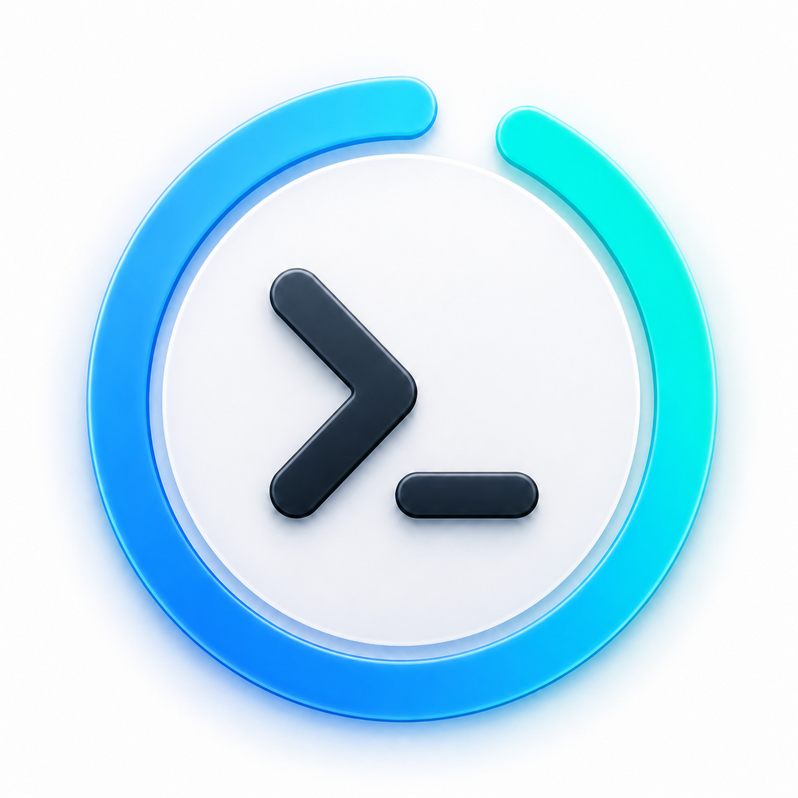

<div align="center">
  
  <h1>Codex Meter for iOS</h1>
  <p>A native SwiftUI app for viewing Codex usage limits across multiple ChatGPT accounts.</p>
</div>

> [!IMPORTANT]
> Codex Meter is an unofficial community project. It is not affiliated with or
> endorsed by OpenAI. ChatGPT and Codex are trademarks of OpenAI.

## Overview

Codex Meter shows the rolling and weekly Codex allowances associated with your
ChatGPT accounts. It runs natively on iPhone and iPad, stores credentials in the
Keychain, supports WidgetKit, and has no analytics, advertisements, or hosted
application backend.

The interface follows the device appearance automatically: AMOLED black and blue
in Dark Mode, and white and blue in Light Mode. On iOS 26 it uses Liquid Glass;
earlier supported releases receive a native material fallback.

## Features

- Multiple ChatGPT accounts displayed together
- Browser OAuth with PKCE or device-code authorization
- Optional profile nicknames and persistent drag-to-reorder account ordering
- Rolling five-hour and weekly usage meters with missing-window fallback
- Reset-credit inventory and redemption
- Pull-to-refresh, cached offline values, and per-account refresh
- Configurable background refresh requests at 5, 10, 15, 30, 60, or 120 minutes
- Local notifications for scheduled and unexpectedly observed resets
- Small and medium home-screen widgets using an App Group cache
- Demo mode with local sample data for review and screenshots
- Optional private Codex CLI proxy over Tailscale
- Light and dark app-icon appearances
- No analytics, ads, public relay, or remote-push credential requirement

## Requirements

- iOS or iPadOS 17 or newer
- A ChatGPT account with Codex access
- Swift 6 and [xtool](https://github.com/xtool-org/xtool) to build from source
- For the optional CLI proxy: Python 3.10+, Codex CLI, and Tailscale

## Install

### TestFlight

Install the current public beta through TestFlight:

[**Join the Codex Meter TestFlight beta**](https://testflight.apple.com/join/49HSCXuv)

TestFlight builds expire after 90 days.

### IPA download

The latest IPA is available from
[GitHub Releases](https://github.com/Anonmike/Codex-Meter-iOS/releases/latest/download/CodexMeter.ipa)
for use with Feather, AltStore, or another sideloading/signing tool. The release
IPA is packaged by `xtool` and must be signed with a certificate accepted by the
target device before installation.

### Build from source with xtool

Clone the repository, configure the Darwin Swift SDK, and build:

```bash
git clone https://github.com/Anonmike/Codex-Meter-iOS.git
cd Codex-Meter-iOS
xtool setup
xtool dev build
xtool dev build --ipa
```

Build products are written to:

- `xtool/CodexMeter.app`
- `xtool/CodexMeter.ipa`

For development signing and installation on a connected device:

```bash
xtool auth login
xtool devices
xtool dev
```

To install an already packaged development IPA:

```bash
xtool install --usb xtool/CodexMeter.ipa
```

## Configure a fork

The checked-in identifiers belong to the upstream app. Before signing your own
fork, replace all occurrences of the following with identifiers owned by your
Apple Developer team:

- `com.picklemike.codexmeter`
- `com.picklemike.codexmeter.widget`
- `group.com.picklemike.codexmeter`
- `com.picklemike.codexmeter.proxy-refresh`

The values occur in `xtool.yml`, the app and widget entitlements, the Info
property list, shared storage, Keychain service names, background refresh code,
and the Codemagic workflow. Create matching App IDs and an App Group in Apple
Developer, enable App Groups for both targets, and regenerate the provisioning
profiles after attaching the group.

## Codemagic and TestFlight

[`codemagic.yaml`](codemagic.yaml) contains two workflows:

- **Codex Meter — IPA artifact** builds an unsigned/pseudo-signed IPA artifact on
  pushes to `master`.
- **Codex Meter — TestFlight** is run manually, uses signing identities stored in
  Codemagic, increments the build number, builds the app and widget, and uploads
  the IPA to App Store Connect.

Fork maintainers must replace the App Store Connect integration name, bundle
identifiers, versioning policy, and signing profiles. Do not commit certificates,
private keys, provisioning profiles, or App Store Connect credentials. See
[`CODEMAGIC.md`](CODEMAGIC.md) for the complete setup.

## Optional Codex CLI proxy

The included relay can display the account currently signed into Codex CLI on a
Mac or Linux computer. The relay communicates with `codex app-server` over local
stdio and exposes only normalized usage and reset-credit operations to the app.
It does not send the computer's Codex `auth.json` or OAuth credentials to the
phone.

On a computer connected to the same tailnet as the iPhone:

```bash
codex login status
./Proxy/install.sh
```

Copy the generated `codexmeter://` setup code, then choose **Add account → Codex
CLI proxy** in the app. The relay binds to localhost and is exposed privately via
Tailscale Serve HTTPS with a random bearer token. Do not expose it with Tailscale
Funnel. See [`Proxy/README.md`](Proxy/README.md) for operations and troubleshooting.

## Authentication and privacy

Direct accounts authenticate with OAuth authorization code + PKCE or OpenAI's
Codex device-code flow. Access, refresh, and ID tokens are stored in the iOS
Keychain with `kSecAttrAccessibleAfterFirstUnlockThisDeviceOnly`. Signing out
removes local credentials and requests token revocation.

Only allowance snapshots needed by WidgetKit are copied into the shared App Group
container. Widgets never receive OAuth tokens and never contact OpenAI or a proxy
computer directly. Proxy bearer tokens are stored in a separate Keychain service.

The app currently communicates with these services:

- `auth.openai.com` for authentication and token lifecycle
- `chatgpt.com` for Codex usage and reset-credit operations
- A user-configured private `*.ts.net` endpoint for optional proxy accounts

No behavioral analytics or advertising SDK is included.

## Background refresh and notifications

iOS background refresh is best-effort. The selected interval is the earliest time
the app asks iOS to run; actual execution depends on system scheduling, battery,
network availability, usage patterns, and whether Tailscale can reach a configured
proxy. Opening or manually refreshing the app always requests fresh values.

Reset alerts are local notifications. This project does not require an APNs
provider key, register device tokens with a project server, or operate a remote
push service.

## Project structure

```text
Sources/CodexMeter/        SwiftUI app, auth, storage, refresh, and notifications
Sources/CodexMeterCore/    Shared usage models and response parsers
Sources/CodexMeterWidget/  WidgetKit extension
Tests/                     Parser and behavior tests
Proxy/                     Optional Tailscale/Codex CLI relay
Resources/                 App icons and asset catalog
Scripts/                   Codemagic Xcode-project preparation
```

## Verify changes

Compile the app and test bundle for iOS:

```bash
swift build --build-tests --swift-sdk arm64-apple-ios -Xswiftc -disable-batch-mode
```

Build and validate an IPA:

```bash
xtool dev build --ipa
unzip -t xtool/CodexMeter.ipa
```

Test the Python relay:

```bash
python3 -m unittest discover -s Proxy/tests -v
bash -n Proxy/install.sh Proxy/uninstall.sh
```

## Platform stability

The ChatGPT usage, reset-credit, and device-authorization routes used here are
implementation details rather than a supported public SDK contract. OpenAI may
change response formats, authentication behavior, eligibility, or availability at
any time. Parser compatibility and graceful missing-window behavior reduce this
risk but cannot eliminate it.

## Contributing

Issues and focused pull requests are welcome. Please avoid including account data,
OAuth tokens, setup codes, signing material, or screenshots containing personal
information. For code changes:

1. Create a branch from `master`.
2. Keep changes scoped and follow the existing Swift style.
3. Add or update tests for parser and model behavior.
4. Run the verification commands above.
5. Explain user-visible behavior and privacy implications in the pull request.

For a security-sensitive report, use GitHub's private security advisory feature
instead of opening a public issue.

## Credits

- The app's original feature set and usage-monitor concept were inspired by the
  Android version of the MIT-licensed
  [Codex Meter](https://github.com/BenItBuhner/Codex-Meter) project by
  BenItBuhner and contributors.
- Built with [SwiftUI](https://developer.apple.com/xcode/swiftui/),
  [WidgetKit](https://developer.apple.com/widgets/), and
  [xtool](https://github.com/xtool-org/xtool).

## License

Codex Meter for iOS is available under the [MIT License](LICENSE).
